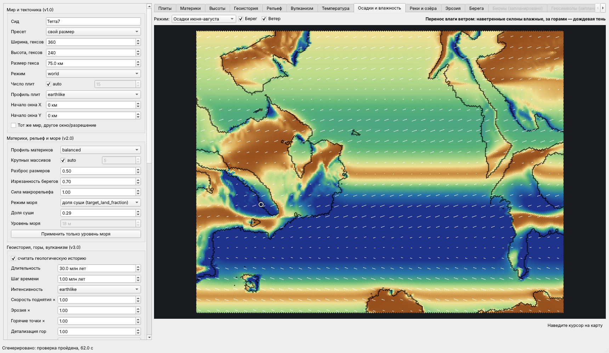
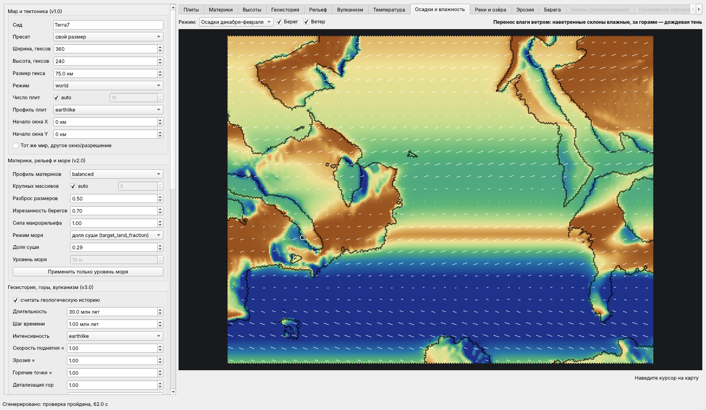
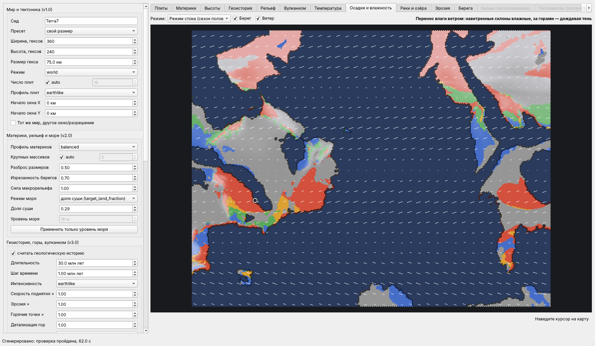
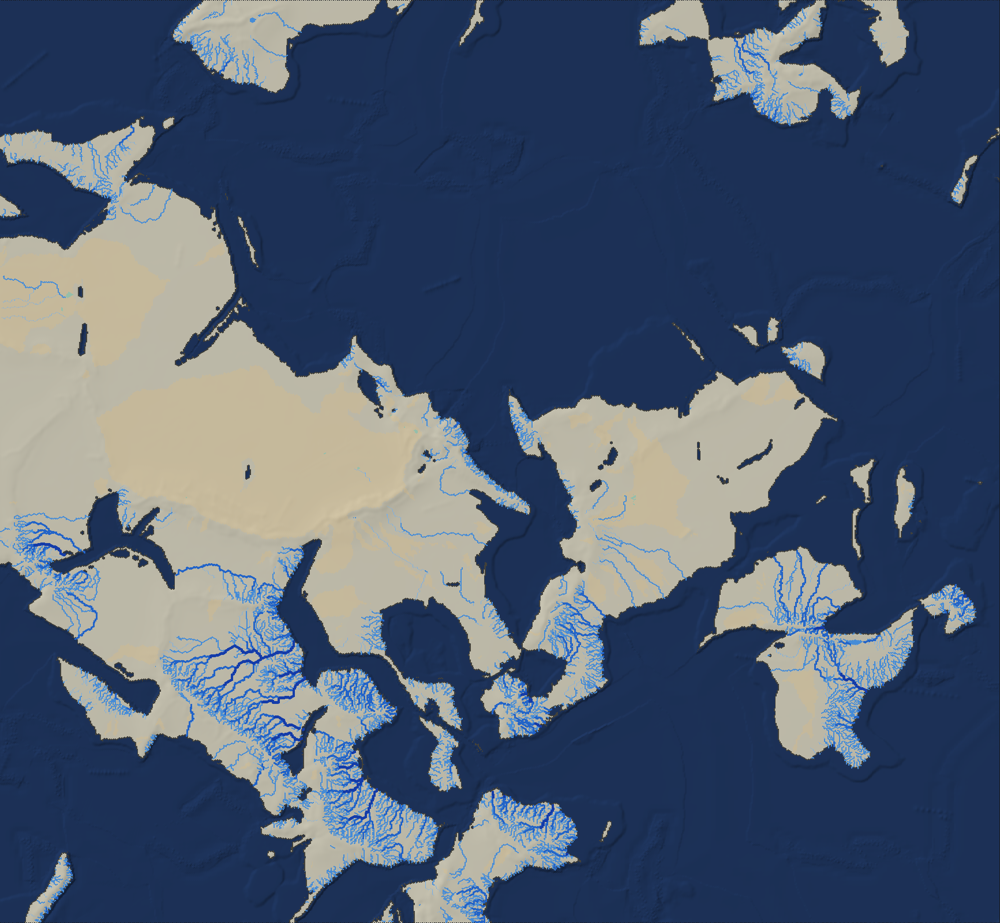
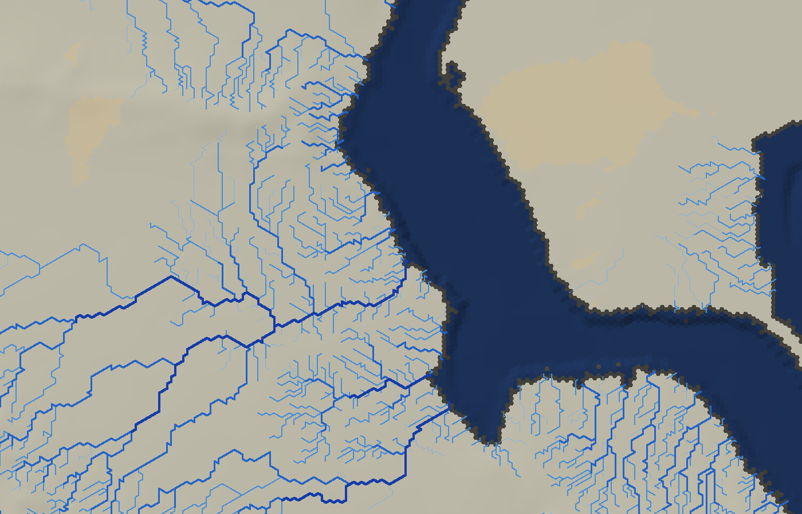

# HexWorld 4.2 — сверка с инженерным мануалом

Дата: 16.11.2026. Ветка `claude/laughing-goldberg-gu0z9w`.

Задача: улучшить генератор по `HEXWORLD_ENGINEERING_MANUAL_V1`. То, что уже работает,
не трогать; сравнить и адаптировать материалы; показать скриншоты; проверить карту
1000×800.

Сопутствующие документы:

| Документ | Что в нём |
|---|---|
| `docs/manual_compliance.md` | каждый пункт §12 и §13 мануала: статус и тест |
| `docs/algorithm_decisions.md` | формула, единицы, источник, причина выбора, ограничения, тест и цена каждого изменённого алгоритма (формат §14) |
| `docs/research/source_matrix.md` | сторонние проекты: коммит, лицензия, прочитанные файлы, подтверждено ли заявление, взято или отклонено (формат §15) |

```text
Тесты:   171 (148 прежних + 23 по пунктам мануала): 167 обычных проходят (Linux, 12 мин в 3 потока),
         медленный тест двух окон — тоже; большие карты (slow) и Windows — в CI
GUI:     реальное окно Qt (xcb) на виртуальном X-сервере Xvfb; физический монитор — нет
1000×800: 261 с, пик памяти 2,0 ГБ, все проверки v4 пройдены
```

## 1. Что сверено и что оставлено как есть

Сначала я прошёл мануал по пунктам и сравнил его с кодом. Большая часть уже соответствовала:

- D6 и priority-flood на копии высот;
- озёра по водному балансу;
- неявный stream power;
- консервативная склоновая диффузия;
- баланс наносов;
- единицы и §12;
- проверки G01–G07.

Эти части **не менялись**: к ним только добавлены тесты с номерами мануала
(`tests/test_manual.py`).

Расхождения, которые исправлены:

| Пункт мануала | Было в 4.1 | Стало в 4.2 |
|---|---|---|
| §5.1 сезоны | только среднегодовой климат | 4 сезона, противоположные в полушариях |
| §5.2 массо-сохраняющий перенос влаги | полулагранжев шаг, без бюджета | конечные объёмы, бюджет E − P ± граница = ΔM |
| §5.3, §6.1 снег и водный баланс | годовая кривая Будыко, снег — оценка | снег, таяние по градусо-дням, почва, грунтовые воды по сезонам |
| §6.2 п.4 край окна | каждый краевой гекс — сток наружу | сток наружу только там, где его даёт сток мира |
| §6.4 маршрут не зависит от окна | **43 %** одинаковых направлений стока в общей части двух окон | **100 %** |
| §7.1 порог размыва E_c | нет | есть (0 по умолчанию) |
| §6.3 ширина и глубина русла | нет | W = 5 Q^0,5, D = 0,3 Q^0,4 |

## 2. Сезонный климат

**Сезоны.** DJF, MAM, JJA, SON. Летом северного полушария идёт JJA, южного — DJF. Пояса
ветров и дождей сдвигаются к летнему полушарию: над океаном на ~6°, над большими
материками до ~16°. Муссонный ветер дует вниз по градиенту сезонной аномалии температуры:
летом к тёплой суше, зимой от неё.

**Перенос влаги** — конечные объёмы против потока. Вода переходит из ячейки в ячейку
через грани, поэтому не теряется и не берётся ниоткуда. Шаг дробится так, чтобы ни одна
ячейка не отдала больше, чем у неё есть. Потоки через внешнюю границу считаются отдельно.
Бюджет мира за год на Terra7, в мм/год среднего по миру:

```text
испарение 828,6 − осадки 826,1 + приток через границу 27,9 − отток 30,4
  = изменение запаса −0,0008;   невязка 6e-13 мм/год (относительная 7e-16)
```

Оператор переноса собирается один раз на сезон как разреженная матрица. Шаг стал в 3,6
раза быстрее, чем при работе со срезами массивов. Климат мира на растре 512×450 считается
5,1 с (в 4.1 — 3,5 с без сезонов).

**Водный баланс гекса** по сезонам:

- доля снега — по нормальному распределению суточных температур вокруг +1 °C;
- таяние — 3 мм на градусо-день, с ожидаемой суммой положительных температур;
- почва — «ведро» 150 мм, испарение по кривой Фу;
- избыток делится на быстрый сток, подпитку грунтовых вод и глубокие потери;
- грунтовые воды разгружаются в реки с временем ~1 год;
- снег, который не успевает растаять, — равновесный ледник: его годовой прирост уходит
  стоком в тёплый сезон.

Баланс `P = ET + сток + потери + ΔS` сходится в каждом гексе с невязкой ~1e-11 мм.
Все запасы начинают с нуля и монотонно растут к годовому циклу. Поэтому за отчётный год
ни один запас не теряет воду, и испарение никогда не превышает осадков (это проверяет
валидатор).

Новые слои:

- `temperature_djf_c`, `temperature_jja_c`;
- `precipitation_djf_mm`, `precipitation_jja_mm`;
- `runoff_peak_season` — сезон половодья;
- `snowmelt_share` — доля талых вод;
- `baseflow_index` — доля подземного питания.




Летом северного полушария пояс дождей уходит на север, и берега северных тропиков
заливает муссон. Зимой дожди смещаются к югу.



Цвет показывает сезон наибольшего стока. Красный — июнь–август: северные тропики и
северные полярные земли с летним таянием. Синий — декабрь–февраль: южное лето. Светлее —
больше талых вод. Серый — стока нет (пустыни).

Температура по сезонам: `screenshots/v6/v6_1_temperature_djf.png`,
`v6_2_temperature_jja.png`.

### Сравнение с Землёй

Сравнение до и после, те же 3 мира 360×240 по 75 км (`docs/realism_v4.md`):

| Мир | Осадки на суше, мм/год | Сток / осадки | Аридные земли | Бессточные | В диапазоне |
|---|---|---|---|---|---|
| Terra7 | 664 → 749 | 0,50 → 0,51 | 0,17 → 0,15 | 0,13 → **0,04** | 22 → 21 из 25 |
| Mundo42 | 878 → 974 | **0,58 → 0,55** | **0,36 → 0,24** | 0,30 → 0,13 | 22 → 24 из 25 |
| Kq3Lm | 501 → 628 | 0,64 → 0,66 | 0,17 → 0,19 | 0,11 → 0,07 | 22 → 22 из 25 |

Земля: ~800 мм/год, сток/осадки 0,36–0,40, аридных ~0,20, бессточных ~0,18.

- Mundo42 вошёл в диапазон по аридности и стоку.
- У Terra7 доля бессточных областей упала ниже земной: муссоны теперь доносят дождь в
  его котловины, и озёра там переливаются.
- Высокий сток в Kq3Lm объясняется не моделью, а географией. Около половины его суши
  лежит за 60° (у Земли без Антарктиды — гораздо меньше), а там сток на Земле тоже
  0,6–0,8.

**Попробовано и отклонено.** Испарение выпавшего на сушу дождя как главный источник влаги
внутри материков. Оно делает влажные побережья ещё влажнее, а сухие внутренние районы
почти не поливает.

## 3. Реки и край окна

**Край окна.** Раньше каждый краевой гекс был стоком наружу, и бассейны, разрезанные
окном, «вытекали» вбок. Теперь вода уходит из окна только там, где её уносит сток всего
мира (грубая сеть стока мирового растра). Если край окна совпадает с краем мира, вся
сторона остаётся выходом.

Замер на региональном окне 300×200 по 30 км (Terra7):

| | все краевые гексы — выходы (4.1) | выходы по стоку мира (4.2) |
|---|---|---|
| краевых выходов | 353 | 59 |
| уходит через край окна | **21 453 м³/с** | 989 м³/с |
| втекает извне | 26 044 м³/с | 26 044 м³/с |
| доходит до моря через устья | 75 130 м³/с | **90 903 м³/с** |

Почти весь приток извне раньше тут же вытекал через соседний край. Цена: где мелкая сетка
гексов даёт впадину у края, а мировой сток выхода там не видит, появляется озеро у края
окна (здесь 3,6 % суши). Ореол из гексов за краем окна — в планах.

**Маршруты не зависят от окна.** В 4.1 случайный выбор нижнего соседа (Rho8, дающий
ветвистую сеть) брал числа по номеру гекса в окне. Один и тот же гекс мира в двух окнах
получал разные числа и тёк в разные стороны.

Два окна 160×110 одного мира со сдвигом 20 столбцов и 10 строк сравнивались по 3 342
гексам общей суши:

```text
4.1: одинаковое направление стока у 43 % гексов
4.2: у 100 %; расход по 175 речным гексам: медианная разница 0, у 82 % — меньше 10 %
     (остальное — бассейны, разрезанные краем одного из окон)
```

Теперь число гекса — хэш сида и мирового положения гекса.

**Русла.** У каждого сегмента реки есть ширина, глубина и скорость, а у речных гексов —
слои `river_width_m`, `river_depth_m`. Например, при 1000 м³/с русло ~160 м шириной,
~4,8 м глубиной, ~1,3 м/с. Те же формулы задают ширину для потерь воды в руслах пустынь.

**Эрозия.** Добавлен порог размыва E_c. По умолчанию он 0, так что эрозия 4.1 сохранена.
Добавлен режим «Тектоническое поднятие» на вкладке «Эрозия»
(`screenshots/v6/v6_7_erosion_uplift.png`).

## 4. Проверка на карте 1000×800

Bench1, 1000×800 гексов по 40 км, 40 000 × 32 000 км, история 30 млн лет. Замеры на Linux,
4 ядра; Python 3.13.18, NumPy 2.5.4, SciPy 1.18.1.

| Размер | Всего | v1–v2 | v3 | климат v4 | эрозия v4 | сеть рек | только порог рек | запись | проект | пик памяти | рек | озёр |
|---|---|---|---|---|---|---|---|---|---|---|---|---|
| 360×240, 75 км (Terra7) | 45,9 с | 11,7 | 25,2 | 5,1 | 3,2 | 0,5 | 1,1 с | 1,7 с | 46 МБ | 577 МБ | 400 | 7 |
| 500×300, 40 км | 66,6 с | 18,4 | 32,4 | 5,5 | 8,8 | 1,1 | 2,1 с | 2,2 с | 56 МБ | 716 МБ | 454 | 23 |
| **1000×800, 40 км** | **261,4 с** | 90,4 | 122,4 | 5,1 | 36,9 | 5,1 | 9,4 с | 6,7 с | 180 МБ | **2025 МБ** | 1807 | 49 |

Для сравнения, 4.0 на 1000×800: 246,7 с и 2469 МБ. Время выросло на 6 % за счёт сезонов,
пик памяти снизился на 18 %.

На 1000×800:

- проверки v4 пройдены;
- невязка бюджета влаги 1e-15, водного баланса 5e-12 мм;
- невязка наносов −25 м³ на миллиарды кубометров;
- осадки на суше 681 мм/год, сток/осадки 0,39 (Земля 0,36–0,40);
- наибольший расход 142 700 м³/с (Амазонка ~209 000).




Также: `1000x800_regime.png`, `1000x800_precip_jja.png`, `1000x800_temperature_jja.png`,
`1000x800_coasts.png`, `1000x800_relief.png`.

**Интерфейс** (Terra7 360×240, реальное окно Qt под Xvfb): генерация 45–62 с,
переключение вкладок и режимов 0,12–0,34 с без пересчёта.

## 5. Тесты

`tests/test_manual.py` — 23 теста по номерам мануала:

- все контрольные расчёты §12: гекс со стороной 10 км, 700 км дрейфа, +500 м поднятия,
  −9,75 °C на 1500 м, 0,019 м³/с, S = 0,005, 0,0004 м/год, затопление на −1 м,
  слияние 3 + 5 + 2 = 10, доля суши 0,4;
- C01, C03 (2 теста), H01, H02/H03, H04, H05, H06, H07 (3 теста), E01, E02, E05;
- гидравлическая геометрия;
- устойчивость маршрута при сдвиге окна (быстрый и медленный тест).

Найдено и исправлено тестами:

- случайные числа маршрута зависели от окна (§6.4);
- ледниковый сток не попадал в сезоны, и полярная суша показывала «половодье» зимой;
- ключ кэша климата не учитывал настройки притока и выходов из окна.

Одно отклонение от H02 оставлено намеренно: второй выход озера связан через озеро с его
единственным истоком. Оба гекса принадлежат озеру; так устроен баланс озёр с 4.0.

## 6. Совместимость

- `climate-2`, `hydro-3`: данные v4 из 4.0/4.1 не загружаются молча, а пересчитываются
  (`hexworld climate`); v1–v3 остаются.
- Прежнее поведение доступно настройками:
  - `--edge-outlets all` — края окна;
  - `--incision-threshold 0` — эрозия (по умолчанию).

## 7. Что не сделано

- Ореол гексов за краем окна для стока (мануал §6.2 п.4, вторая часть).
- 12 месяцев вместо 4 сезонов.
- Сила Кориолиса в муссоне.
- Динамика ледников и фьорды по истории льда (§7.4).
- Острова по происхождению (I01).
- Меандры.
- Проекты из разделов B и C каталога мануала **не открывались**. Список того, что
  прочитано, а что нет, — в `docs/research/source_matrix.md`.
