# HexWorld 4.5 — экологический фундамент, дно океана, горные страны

Дата: 21.11.2026. Ветка `claude/laughing-goldberg-gu0z9w`.

```text
Тесты: 197 (193 обычных + 4 slow) — проходят на Linux; CI на Windows 3.12 / 3.13 и Linux — зелёный
GUI:   реальное окно Qt (xcb) на Xvfb; физический монитор Windows — NOT VERIFIED
Биомов в 4.5 нет (по ТЗ): только условия среды для будущего классификатора
```

## 1. Дно океана: что там сгенерировано

**Генерация.** Глубины уже были физическими:
- новая океаническая кора опускается с возрастом (−2600 − 350·√возраст м);
- у зон субдукции — желоб и краевой вал;
- у материков — шельф и склон;
- на дне — вулканы и осадки.

**Беда была в карте:** весь океан глубже 4 км — один тёмно-синий тон, и ничего не прочесть.

**Что сделано.**

- **Ступени глубин, как в физическом атласе**, во всех картах высот (вкладки «Высоты», «Рельеф», «Эрозия»):

  | Глубина, м | Что это обычно |
  |---|---|
  | 0–200 | шельф |
  | 200–1000 | бровка и верх склона |
  | 1000–2000, 2000–3000 | склон, гребни хребтов |
  | 3000–4000, 4000–5000 | подножие, абиссаль |
  | 5000–6000 | глубокие котловины |
  | 6000–7000 | **желоба — почти чёрные** |
  | > 7000 | **дно желобов — чёрное** |

- **Формы дна** (`stages/ocean.py`) — каждый гекс моря называется по глубине, возрасту коры и тектонике:
  - шельф, материковый склон, материковое подножие;
  - абиссальная равнина, абиссальные холмы;
  - ось срединного хребта (кора моложе 8 млн лет), его склоны (8–30 млн лет);
  - глубоководный желоб;
  - подводные горы (вулкан или выступ мельче, чем позволяет возраст коры);
  - океаническое плато, окраинная котловина.

  На Terra7: абиссальные равнины 53 %, холмы 16 %, склон 5 %, подножие 5 %, ось и склоны хребтов 10 %, шельф 4 %, желоба 3 %, подводные горы 2 %, плато 1 %.

- **Вкладка «Дно океана»:** глубины, формы дна, возраст коры, осадки, изобаты, оси спрединга и зоны субдукции.
- **Подсказка** называет тип дна и глубину под курсором.

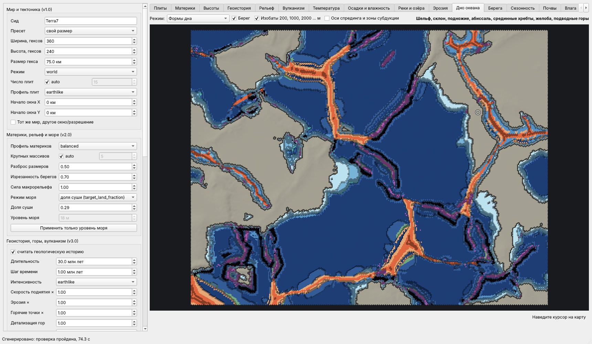

## 2. «Цепочки малых вершин»

Причин нашлось три.

1. **Вулканы, взятые в одной точке.** Конус дуговых вулканов 15–30 км в поперечнике, а гекс — 75 км. Гексу, чей центр попал на конус, доставалась вся вершина (до 4 км), соседям — ничего. Вдоль каждой дуги выстраивались одиночные пики: 225 из 283 «шипов» на Terra7.

   Теперь гекс получает конус, усреднённый по своей площади (объём сохраняется, радиус √(r² + (0,6·шаг)²)):
   - большие щиты (Гавайи) остаются островами;
   - мелкие конусы становятся общим вздутием дуги;
   - на мелкой сетке ничего не меняется.

   Настоящая высота вершины сохранена отдельно (`volcano_summit_m`) и показывается в инспекторе.

2. **Одиночные гексы без причины.** На резких окраинах материков одиночный гекс коры оказывался на 4–5 км выше абиссали вокруг. Правило минимального картируемого объекта: гекс выше всех шести соседей на 350 м без горы и вулкана получает медиану соседей. Затрагивает 19 гексов из 86 400.

3. **Вид вулканических дуг на подробной сетке:**
   - у каждого дугового вулкана общий цоколь — дуга становится хребтом, а не бусами;
   - шаг 40–110 км вместо ровных 68;
   - много мелких конусов и немного крупных;
   - потухшие конусы размываются быстрее;
   - горячая точка на материке строит пологий свод (траппы, равнина Снейк-Ривер), а не нитку конусов.

**Попутно найдены и убраны уступы в рельефе гор:**
- густые отроги скрывали хребет от поиска ближайших;
- гребень брался в вершинах ломаной, а не на отрезке;
- асимметричный склон резко менял ширину;
- углубление долин включалось ступенькой.

Самый крутой шаг сетки 1 км упал с 331 до 87 м. Тест сканирует всю сетку.

## 3. Новые типы гор

Складчатые горы оставлены как есть. Добавлены два строения.

**Горная страна (`highland`)** — Верхояно-Колымская, Становое нагорье, Монгольские нагорья.
- Широкий цоколь и десятки хребтов средней высоты.
- Простирание хребтов поворачивает по всей стране плавным полем: дуги, веера, пересекающиеся направления. Хребты не идут параллельно одной оси.
- Между хребтами — понижения.
- Выбирается для широких (> 650 км) поясов средней высоты, старых или очень широких молодых.

**Горный узел из нескольких складчатых областей (`composite`)** — Памирский узел (Тянь-Шань, Гиндукуш, Куньлунь), Алтае-Саянская область.
- В самой высокой части системы узел. Из него в разные стороны, под углом не меньше 50°, уходят 2–4 пучка параллельных хребтов.
- Пучки расходятся веером (виргация) и снижаются от узла.
- Выбирается для ветвистых поясов 400–1800 км.

На Terra7 из 67 систем: смешанных 19, альпийских 15, складчатых 11, горных стран 8, вулканических дуг 7, горных узлов 6.

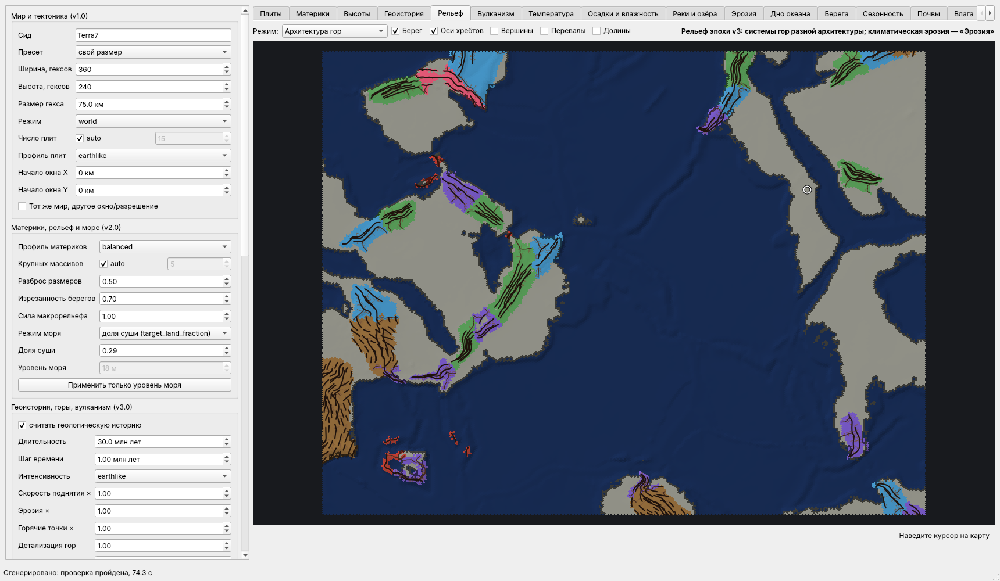

На гексах 75 км хребты горной страны видны штрихами. Отчётливо их видно на сетке 25–40 км.

## 4. ТЗ 4.5 — экологический фундамент

**Gate 0 — аудит** (`docs/v4_5_baseline_audit.md`): поля, производители, единицы, потребители. Ключевой вывод: v4 уже даёт четыре сезона влагопереноса, поэтому месяцы выводятся из физики, а не из синтетического профиля.

**Gate 1 — 12 месяцев.**
- Температура: гармоника сезонных средних. Средневзвешенное по дням годовое совпадает с v4 до 1e-14 °C. Тёплый месяц — июль на севере и январь на юге.
- Осадки: сезонные суммы влагопереноса распределены по трём месяцам гладкой кривой. Сумма сохраняется до 5e-16.
- PET: сезонная PET v4 (температурная эвристика — **не** Пенман–Монтейт) распределена по температуре и длине дня.
- Радиация и длина дня: FAO-56. Пример 8 даёт 32,19 МДж/м²/сут при эталоне 32,2.

**Gate 2 — почвы.**
- Порода — 12 классов: щиты, платформы, складчатые, молодые и выветрелые вулканиты, аллювий, морена, эоловые пески, лёсс, морские и озёрные отложения, склоновый чехол. Выводится из геологии и истории поверхности.
- Текстура: таблица пород + выветривание + плавный шум, привязанный к миру.
- Мощность почвы — статический потенциал.
- FC/PWP/пористость/Ks — Saxton & Rawls (2006); таблица статьи воспроизводится в пределах ±0,015. AWC — по USDA; пример даёт 120 мм.
- Дренаж и засоление.

**Gate 3 — вода по месяцам.**
- Схема §6.2 ТЗ, контрольный месяц: 150 = 10 + 4 + 80 + 56 мм.
- Доля p по FAO-56 зависит от ET (как в USGS SWB).
- Разгон до периодического года: гекс выходит из расчёта, как только его год повторяется.
- Многолетний снег — накопление, а не выдуманный ледниковый сток.
- Невязка баланса около 1e-11 мм.
- Реки остаются из v4. Месячный сток отличается от годового стока v4 на −0,5 % на Terra7, и это показано.

**Gate 4 — рельеф и индексы.**
- TWI по физической площади; HAND вдоль пути стока (водораздел за хребтом не становится поймой — тест).
- Переувлажнение; поймы как доля гекса, которую может занять пойма реки данного расхода.
- Суммы температур, морозные и талые суммы, число мороза и потенциал мерзлоты; холодные, сухие и вегетационные месяцы; сезонность осадков, P/PET, AET/PET; снег.
- Флаги участков и флаги качества данных.

**Gate 5.**
- Вкладки «Сезонность», «Почвы», «Влага», «Экологические параметры» с выбором месяца. Смена месяца — только отображение.
- 12-месячная таблица гекса в инспекторе.
- Сохранение и загрузка отдельными файлами; проект без v4.5 открывается и говорит «не рассчитаны».
- CLI `hexworld environment` и `hexworld months` (CSV).

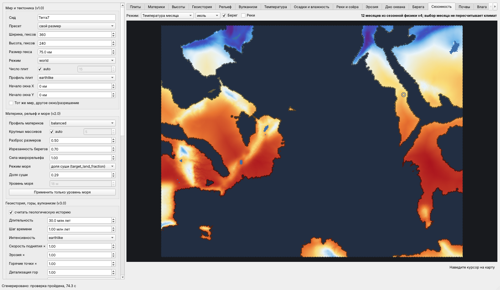
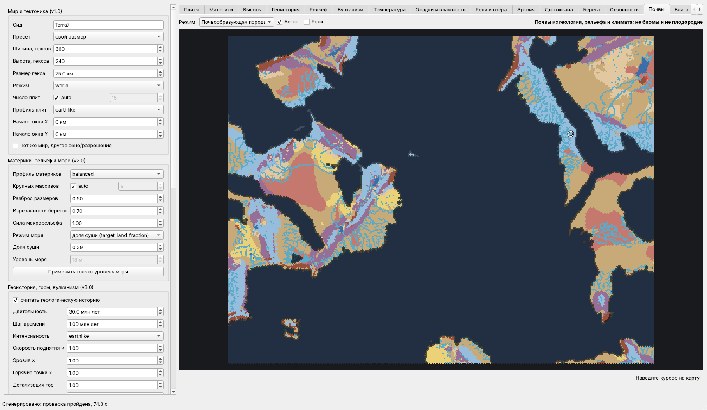
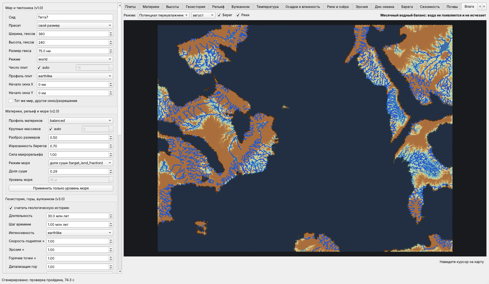

Чувствительность к стартовым значениям — `docs/research/v4_5_parameters_and_calibration.md`. Отклонённые подходы — `v4_5_rejected_approaches.md`. Источники с коммитами и лицензиями — `v4_5_evidence_matrix.md`.

## 5. Замеры

Linux, 4 ядра; Python 3.13.18, NumPy 2.5.4, SciPy 1.18.1.

| Карта | Всего, с | v1–v2 | v3 | v4.5 | Пик памяти | Проект на диске |
|---|---|---|---|---|---|---|
| 100×100 | 54,4 | 9,9 | 37,5 | 0,15 | 640 МБ | 29 МБ |
| Terra7 360×240 | 56,7 | 12,4 | 34,0 | 0,96 | 734 МБ | 61 МБ |
| 500×300 | 77,5 | 18,7 | 40,4 | 3,5 | 1000 МБ | 98 МБ |
| 1000×800 | 336,5 | 109,0 | 156,7 | 13,9 | 3460 МБ | 315 МБ |

- 1000×800:
  - месячные поля занимают 307 МБ в памяти;
  - сохранение 16,4 с;
  - смена только порога рек 25,4 с;
  - все проверки пройдены.
- Для сравнения, 4.2 на 1000×800: 261 с и 2025 МБ. Рост времени — v3 (точный поиск хребтов), рост памяти — v3 и месячные поля.
- Расчёт v4.5 занимает 0,3–4 % общего времени.

### Карта 1000×800 (27 км на гекс)

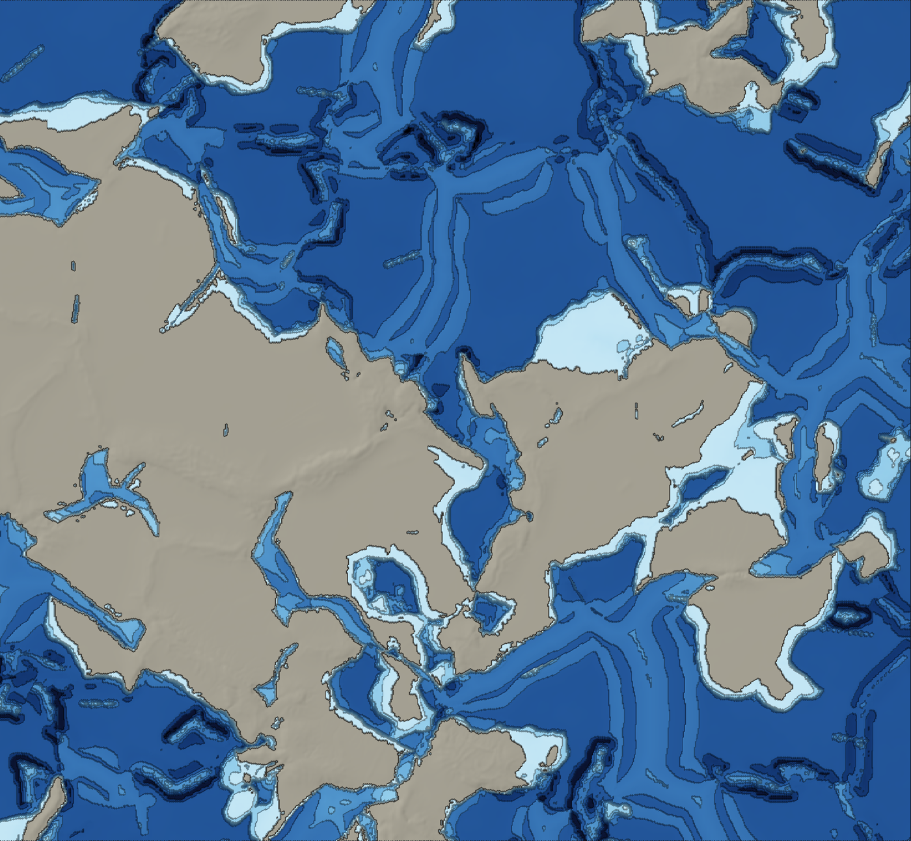
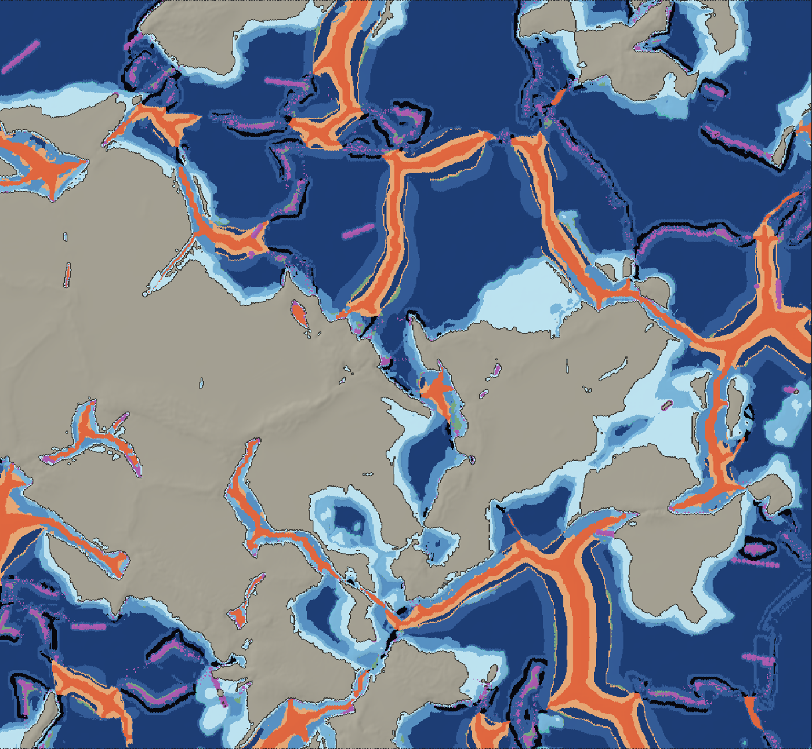
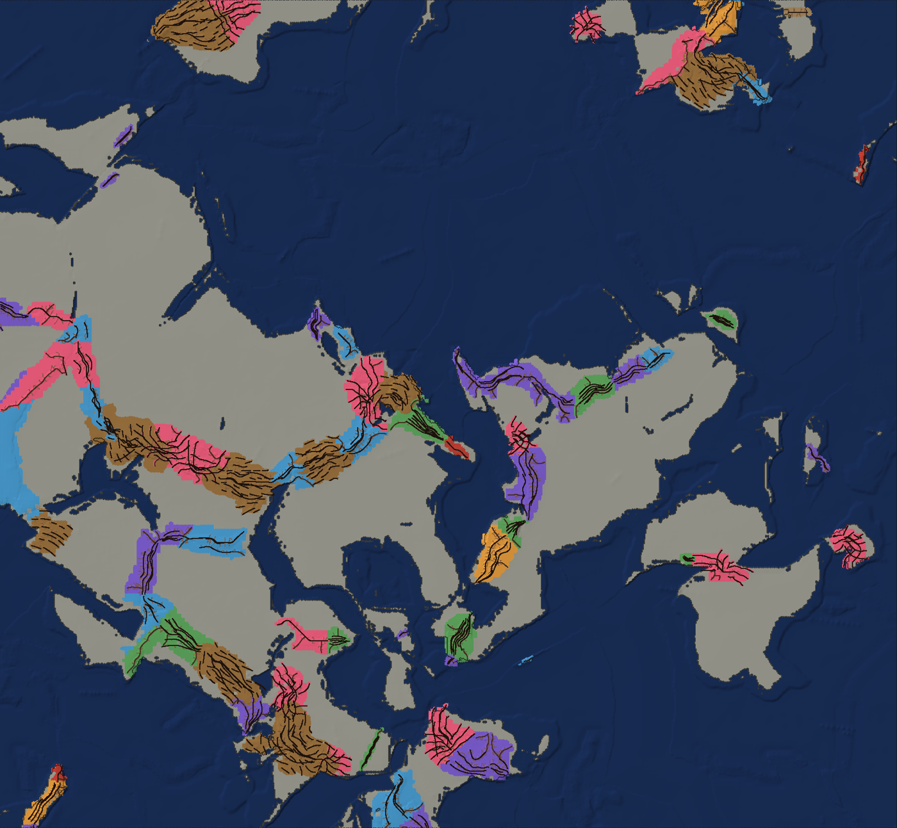
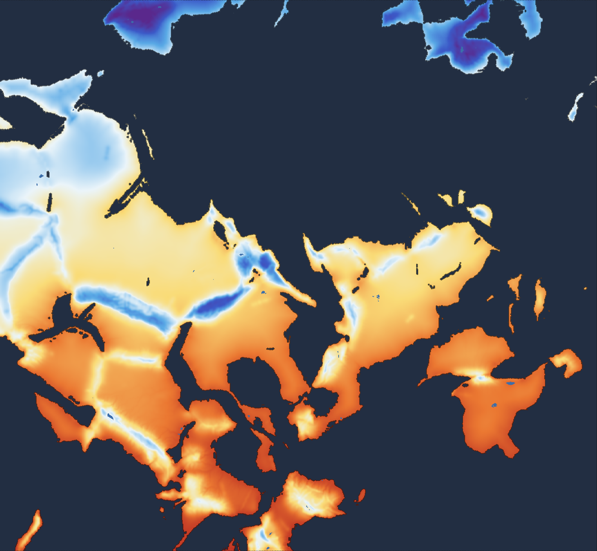
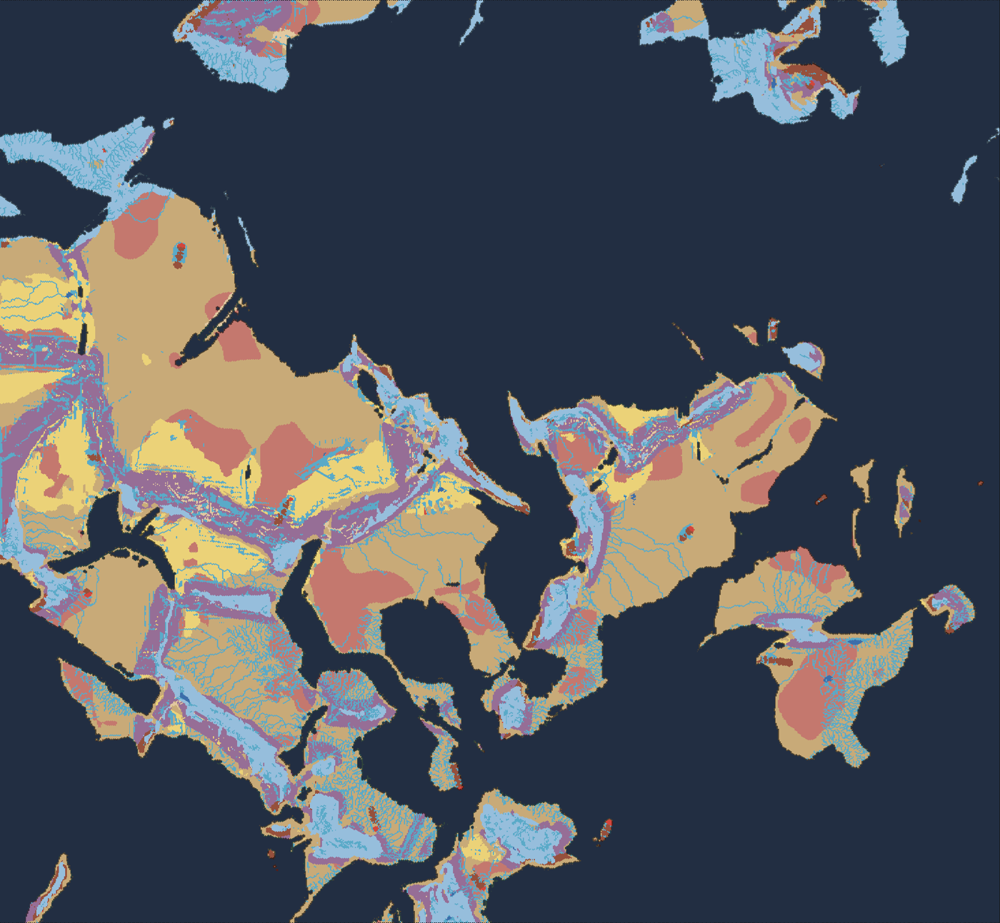
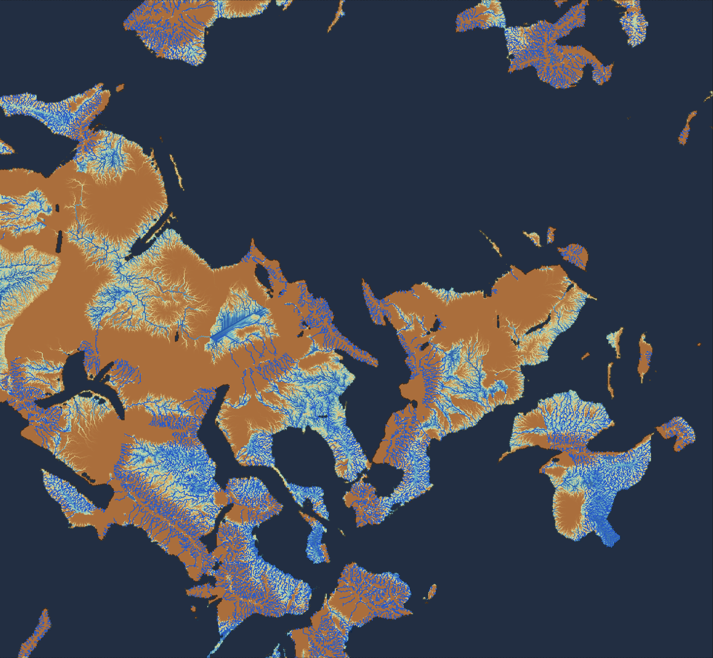

Остальные: `screenshots/v7/big/` (июль, AWC, суммы температур, мерзлота, высоты).

## 6. Что не сделано

- Субгексная береговая линия (`land_fraction` < 1) и `local_environment_patches[]`.
- Ежедневная погода (точные морозные дни).
- Пенман–Монтейт: нет радиационного баланса и ветра на 2 м.
- Обратная связь растительность → вода. Биомы — ТЗ 5.0.
- Проекты из приоритетов B и C каталога ТЗ не открывались.
- На гексах 75 км хребты горной страны различимы плохо.
- Время v3 выросло: точный поиск хребтов и больше хребтов в горных странах.
