# HexWorld 4.6 — массивы, низменности, бассейны, дно океана

Дата: 21.11.2026. Ветка `claude/laughing-goldberg-gu0z9w`. Новый показательный сид —
**Aurelia4** (большой центральный океан, несколько материков); контрольный Terra7 тоже
посчитан.

```text
Тесты:  213 обычных + 4 slow; обычные проходят на Linux (Python 3.13); CI — см. коммит
GUI:    реальное окно Qt (xcb) на Xvfb; экран Windows — NOT VERIFIED
Биомов нет (ТЗ 4.6, 12.8)
```

| Пакет | Реализовано | Протестировано | Экспериментально / приближённо | Не выполнено |
|---|---|---|---|---|
| A вода | связность с мировым океаном; озёра и сухая суша ниже уровня моря; маски; уровни, глубина воды; три доли суши | −500/+100, озеро −430, срез окна, два бассейна, priority-flood | порог «мировой океан» ≥ 1,5 млн км² | доля суши подбирается по `above_datum_fraction` |
| B массивы | графы хребтов (ID, ранги, узлы), перевалы, долины = реки v4, относительная высота вершин, расчленённость, отчёт качества | относительная высота; перевалы ниже вершин на всех мирах | индекс расчленённости — эвристика [А] | долины плана v3 и реки v4 не согласуются итерациями |
| C бассейны | прогибы платформ, предгорные прогибы (изгиб плиты), рифты, pull-apart; фундамент ≠ поверхность | синтетика §9.2 | заполнение осадками — допущение [А] | back-arc на суше, кальдеры, эрозионные котловины |
| D дно | возраст коры от сегментов хребтов, Parsons–Sclater, трансформы и зоны разломов, желоба с валом | §9.3 тесты 14–17 | возраст `approx`; калибровка медианы 65 млн лет [А] | возраст по полной реконструкции движения |
| E окраины, морфология | типы окраин, каньоны и конусы от наносов рек, гайоты, плато, 21 форма дна | §9.3 тесты 18–22 | каньоны — `approximate` | сравнение с GEBCO |
| F интерфейс, данные | 3 вкладки, режим «Вода», разрез с CSV, сохранение и загрузка, CLI | сохранение/загрузка побитово; Xvfb | — | экран Windows |

## 1. Почему дно было непохожим на настоящее

Причин нашлось три.

1. **Глубина не зависела от возраста коры.** Глубина шла от возраста только на полосах
   коры, родившейся за 30 млн лет истории. Остальное дно было плоским −4,4 км с гауссовым
   «горбом» хребта. Отсюда параллельные «террасы» у хребтов и один тёмный тон на всём
   остальном.
2. **Желоб считался дважды.** Желоб v2 уезжал вместе с плитой как окаменелость, а история
   добавляла ещё один, текущий. Получались чёрные штрихи в странных местах.
3. **Возраст коры был просто расстоянием до ближайшего хребта.** Не было сегментов хребта,
   трансформных разломов и зон разломов, то есть главной «ткани» настоящего дна.

## 2. Что сделано с дном (`geomorph/ocean_age.py`, `bathymetry.py`, `margins.py`)

- **Сегменты хребтов.**
  - Ось спрединга перпендикулярна направлению движения плит.
  - Косая граница плит разбивается на короткие сегменты по 40–400 км, сдвинутые друг
    относительно друга.
  - Каждый уступ между сегментами оставляет на обеих плитах зону разломов —
    линию вдоль направления спрединга.
- **Возраст коры = расстояние по направлению спрединга / скорость.**
  - Он запоминается за породой: в слое v3 хранятся координаты породы при t = 0.
  - Поэтому ткань дна и зоны разломов едут вместе с плитой.
  - Карта возраста стала ступенчатой, как настоящие (Müller и др.).
- **Глубина — Parsons–Sclater (1977), заменяет базу v2, а не добавляется к ней.**
  - Контроль: 0 / 25 / 100 млн лет → 2500 / 4250 / 5749 м.
  - Переход между двумя формулами плавный, 60–80 млн лет.
- **Ось хребта** зависит от скорости спрединга:
  - у медленных — рифтовая долина до 1,3 км;
  - у быстрых — осевое поднятие.
  - Обе формы уже гекса, поэтому входят в гекс как среднее по его площади.
- **Ткань дна.**
  - Вытянутые вдоль изохрон гряды, грубее на медленной коре.
  - С возрастом их хоронят пелагические осадки (4 м за млн лет).
  - Медленные плавные вздутия старого дна ±300 м.
- **Желоба.**
  - Только на погружающейся океанической плите.
  - Глубина растёт с возрастом плиты и скоростью сближения и меняется вдоль оси.
  - Перед желобом — краевой вал 250–500 м.
  - Глубочайший желоб: 9,3 км (Aurelia4), 9,5 км (Terra7).
- **Окраины по геологии, не «кольцо вокруг суши»:**

  | Тип | Склон | Подножие |
  |---|---|---|
  | пассивная | ~70 км | широкое, 150–500 км |
  | активная | узкий, круто к желобу | нет |
  | трансформная | крутой уступ ~25 км | короткое |

  - Тип окраины определяется близостью к желобу или к трансформной границе.
  - Профиль — монотонная кубическая кривая (PCHIP) без изломов.
  - Ширины — в километрах, медленно меняются вдоль берега.
  - Шельф — это материковая кора под водой, а не «N гексов от берега».
- **Подводные горы, гайоты, плато.**
  - Гайот — вулкан, вершина которого была срезана у поверхности, а потом погрузилась
    вместе с остывающей плитой. Старый вулкан, не доросший до поверхности, остаётся
    острой подводной горой.
  - Океанические плато ставятся в начале треков горячих точек.
- **Каньоны и конусы выноса** — только где реки v4 приносят к устью много наносов:
  - путь каньона идёт строго вниз по склону;
  - конус ложится у подножия;
  - объём закрыт: размыто + прошло мимо шельфа = отложено в конусах, невязка 0.
- **Формы дна.** 21 класс по геологии, форме и соседству. Доли на Aurelia4:

  | Класс | Доля | Класс | Доля |
  |---|---|---|---|
  | абиссальные равнины | 30 % | материковое подножие | 9 % |
  | абиссальные холмы | 26 % | шельф | 7 % |
  | срединный хребет | 9 % | зоны разломов | 5 % |
  | краевой вал | 4 % | преддуга | 3 % |
  | подводные горы | 1,4 % | желоба | 1,2 % |
  | каньоны | 0,6 % | конусы | 0,7 % |
  | плато | 0,9 % | гайоты | 0,06 % |

  На Terra7 холмов 49 %, а равнин 9 %: у этого мира океаны моложе и меньше осадков.

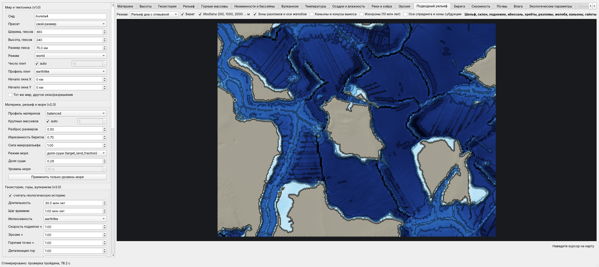
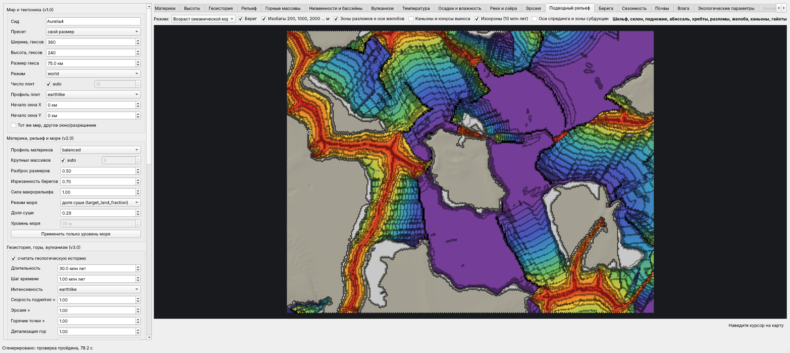
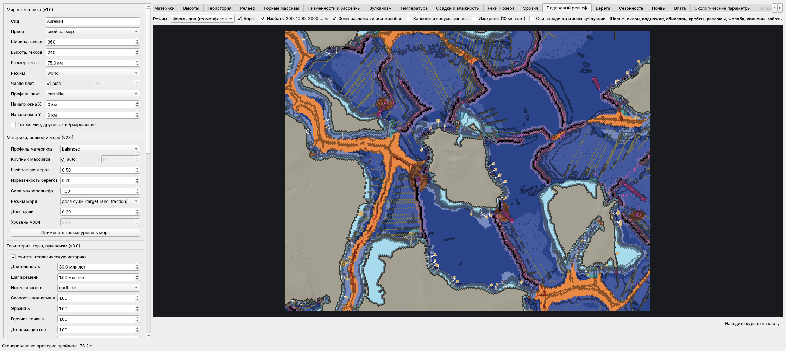

**Калибровка [А].** Медиана возраста стартовой коры не больше 65 млн лет. Базовый мир не
имеет прошлого, а океаны модели широки для своих скоростей. Без калибровки почти всё дно
было бы на насыщенной «старой» глубине 6,2 км. Даже с ней медиана в окне 85–100 млн лет,
и дно глубже земного примерно на 0,5–1 км. Параметр `terrain.target_median_age_ma`.

## 3. Вода: океан — только связный с океаном

Раньше «ниже уровня моря» значило «море». Теперь:

- мировой океан — это связные низины площадью не меньше 1,5 млн км² на мировом растре;
- на гексах океан — только то, что связано с ним через гексы ниже уровня моря;
- замкнутая впадина ниже уровня моря — суша, а будет ли там озеро и какой у него уровень,
  решает водный баланс v4. Сухое дно может остаться ниже уровня моря;
- край окна не считается входом океана; залив, обрезанный окном, остаётся океаном.

Климат, эрозия, реки, берега, проверки и все карты высот работают по связности.

- Впадины ниже уровня моря закрашиваются тёмно-зелёным, озёра — голубым.
- В режиме «Вода» на вкладке «Высоты» видны все четыре класса.

На Aurelia4: 100 гексов сухой суши ниже уровня моря и 87 гексов озёр. На Terra7 — 323 и 140.

## 4. Низменности и бассейны (`geomorph/basins.py`)

| Тип | Причина | Форма |
|---|---|---|
| прогиб платформы | медленное опускание внутренних частей материков | широкий (350–850 км), пологий, контур неправильный, почти заполнен осадками; первый может быть недозаполнен и уйти ниже моря (тип Прикаспия) |
| предгорный прогиб | изгиб упругой плиты под весом гор: D∇⁴w + Δρgw = q, Te = 25 км, α ≈ 80 км | низина вдоль фронта гор, дальше — низкий краевой вал; без гор нет прогиба |
| рифт | расхождение материковых плит в эпоху снимка | сегменты-полуграбены: крутой сбросовый борт меняет сторону от сегмента к сегменту, переходные рампы, плечи |
| pull-apart | только на участках сдвига, где плиты слегка расходятся | узкий ромб между двумя сбросами, 1–2 подкотловины; при сжатии не возникает |

- Фундамент и поверхность хранятся раздельно; поверхность опускается на «опускание −
  осадки».
- Для каждого бассейна известны: низшая точка, порог перелива, уровень озера, число сухих
  гексов ниже моря.
- Узкие рифты и pull-apart (20–60 км) на гексах 75 км видны только как среднее по гексу.
  Это честное разрешение; на 25 км они видны.

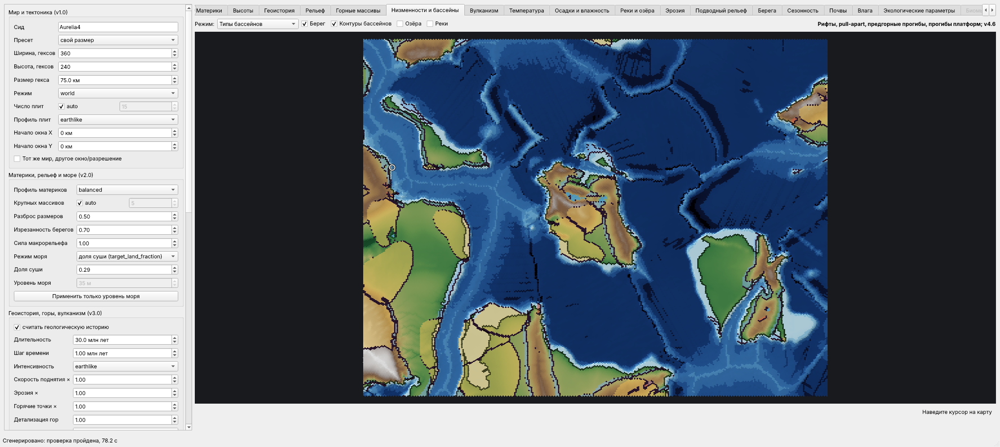
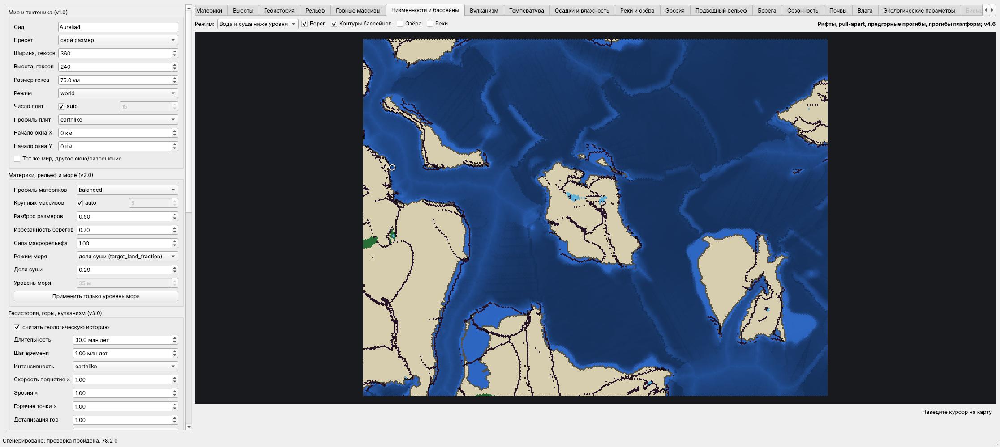

## 5. Горные массивы (`geomorph/massifs.py`)

План гор v3 (хребты, отроги, вершины, перевалы) и реки v4 собраны в план массива:

- граф хребтов: узлы, рёбра с ID и рангом;
- граф долин: реки v4 внутри массива с выходами — море, озеро, бессточная котловина;
- вершины с относительной высотой (prominence);
- перевалы, которые проверяются: ниже ли они обеих вершин;
- индекс расчленённости.

На Aurelia4: 39 массивов, все 1779 перевалов ниже своих вершин. Рек, идущих по гребню, —
98 гексов из всех горных; это гексы, где гребень и тальвег не разделяются сеткой.

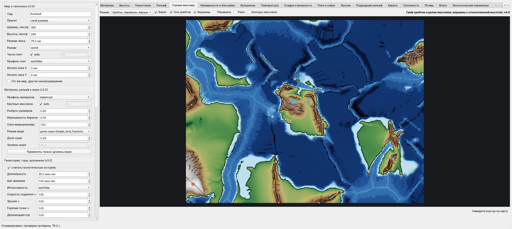

## 6. Интерфейс

- **Новые вкладки:**
  - «Горные массивы»: хребты и вершины, долины, расчленённость, уклоны;
  - «Низменности и бассейны»: типы, вода, замкнутые понижения, опускание фундамента,
    осадки, изменение поверхности.
- **«Дно океана» → «Подводный рельеф»:** отмывка, ступени атласа, формы дна, возраст с
  изохронами, типы окраин; наложения разломов и каньонов.
- **Разрез:** провести линию правой кнопкой мыши по карте. Откроется окно с профилем: одна
  шкала для суши и дна, вода, осадки, фундамент. Кнопка «Сохранить CSV…».
- **Инспектор гекса:** поверхность и фундамент, вода, бассейн, возраст дна, окраина,
  разломы, гайоты, каньоны, относительная высота вершины.
- **CLI:** `hexworld terrain` (сводка) и `hexworld section … --csv`.

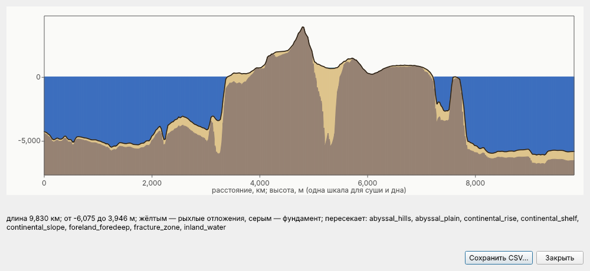

## 7. Замеры

Linux, 4 ядра (замеры шли параллельно со съёмкой GUI — время завышено); Python 3.13.18,
NumPy 2.5.4, SciPy 1.18.1. Всё в одном процессе, `generate()` до v4.5.

| Карта | Всего, с | v1–v2 | v3 | **v4.6** | v4 эрозия | v4.5 | Пик памяти | Проект |
|---|---|---|---|---|---|---|---|---|
| 100×100, 40 км (Bench1) | 80,4 | 11,6 | 42,8 | **6,6** | 0,5 | 0,1 | 575 МБ | 30 МБ |
| Terra7 360×240, 75 км | 68,4 | 13,9 | 36,0 | **7,4** | 3,4 | 1,0 | 786 МБ | 69 МБ |
| Aurelia4 360×240, 75 км | 75,6 | 12,7 | 44,5 | **7,6** | 3,6 | 1,0 | 769 МБ | 63 МБ |
| 500×300, 40 км (Bench1) | 104,9 | 23,3 | 50,9 | **11,8** | 8,4 | 2,9 | 1062 МБ | 110 МБ |
| Aurelia4 1000×800, 25 км | 179,7 | 32,8 | 60,8 | **23,6** | 36,6 | 11,4 | 3578 МБ | 280 МБ |

- v4.6 = до v4 (дно + бассейны + связность) и после v4 (каньоны, вода бассейнов, графы
  массивов, формы дна). На 1000×800: дно 11,9 с, бассейны 5,5 с, после v4 5,8 с.
- Все проверки пройдены на всех картах (v3, v4.6, v4, v4.5).
- Смена только порога рек на 1000×800 — 25 с; v4.6 при этом берётся из кэша.

### Карта 1000×800 (Aurelia4, 25 км на гекс)

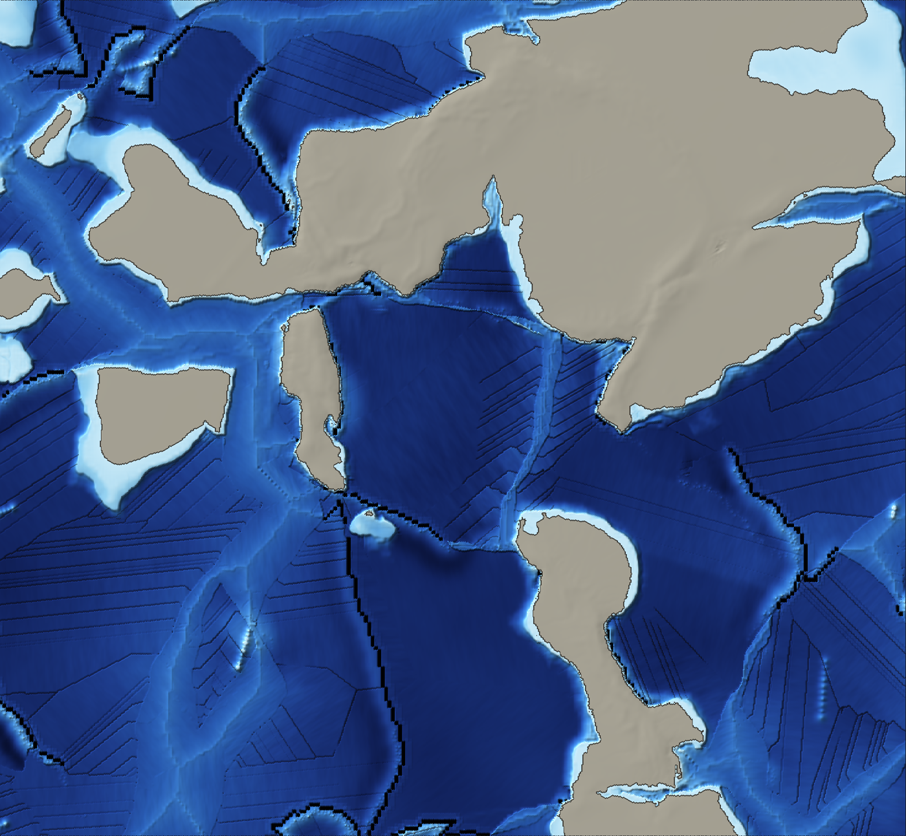
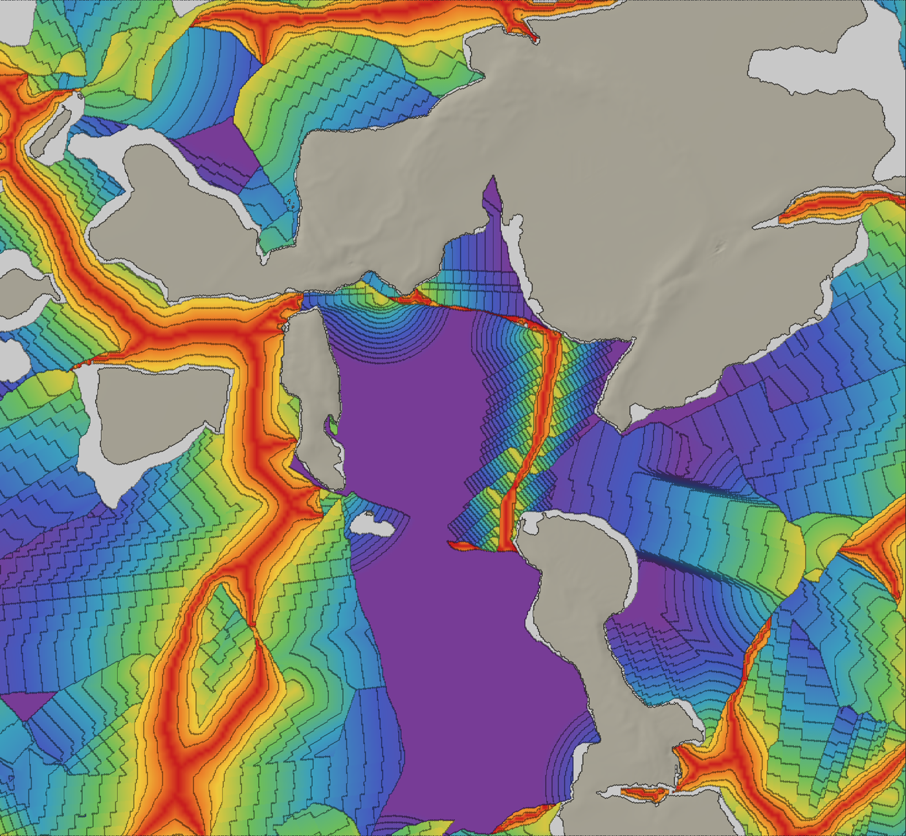
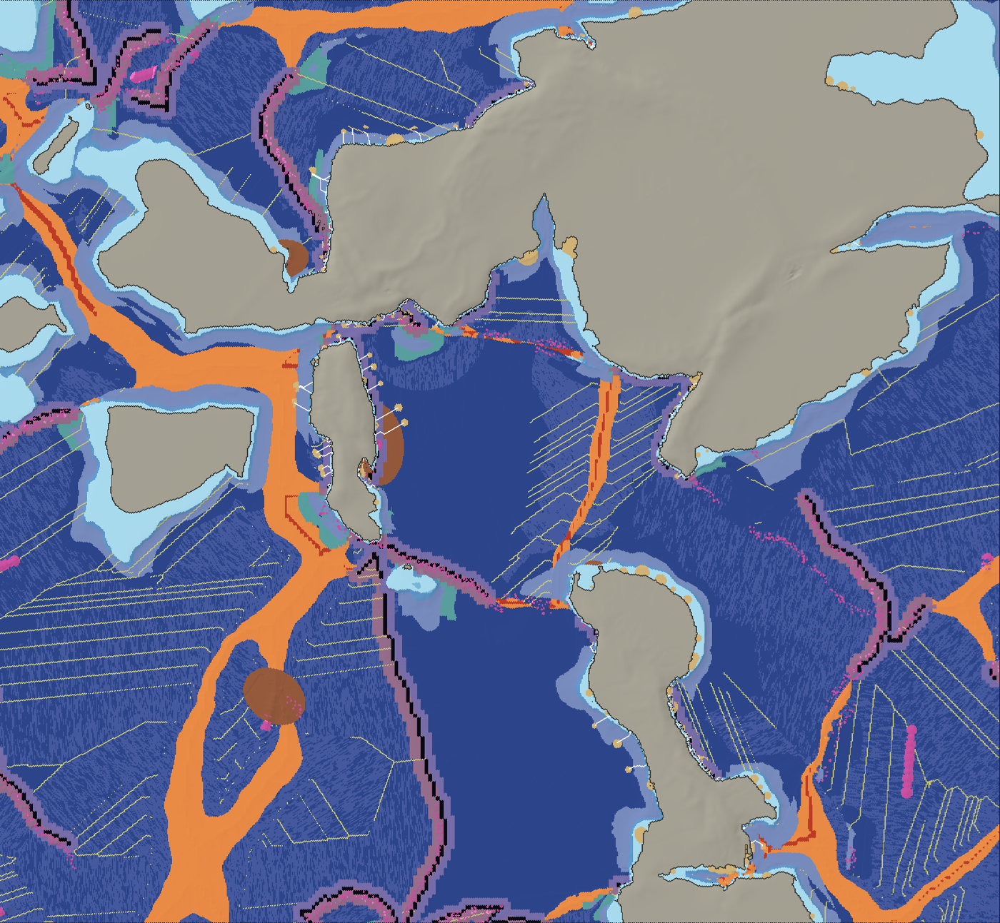
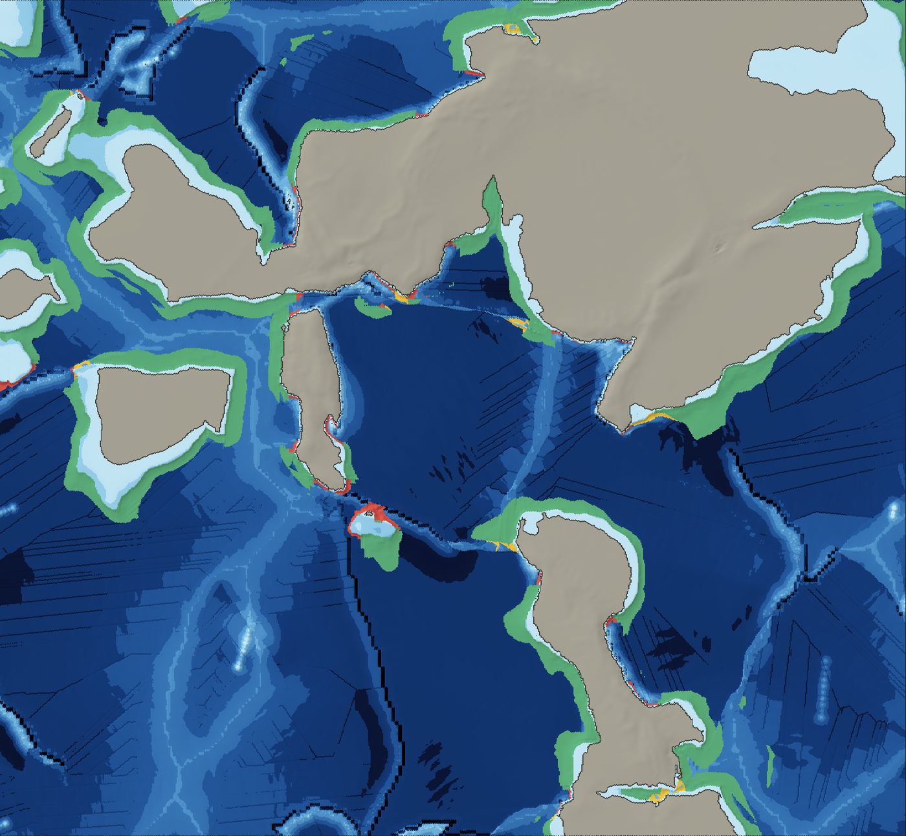
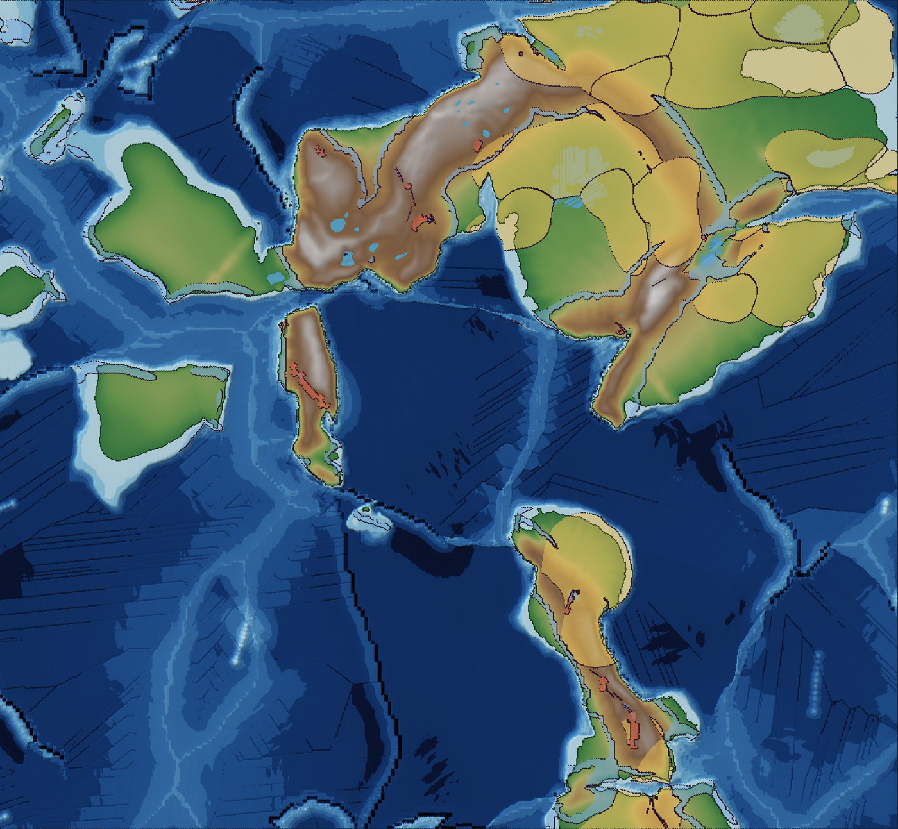
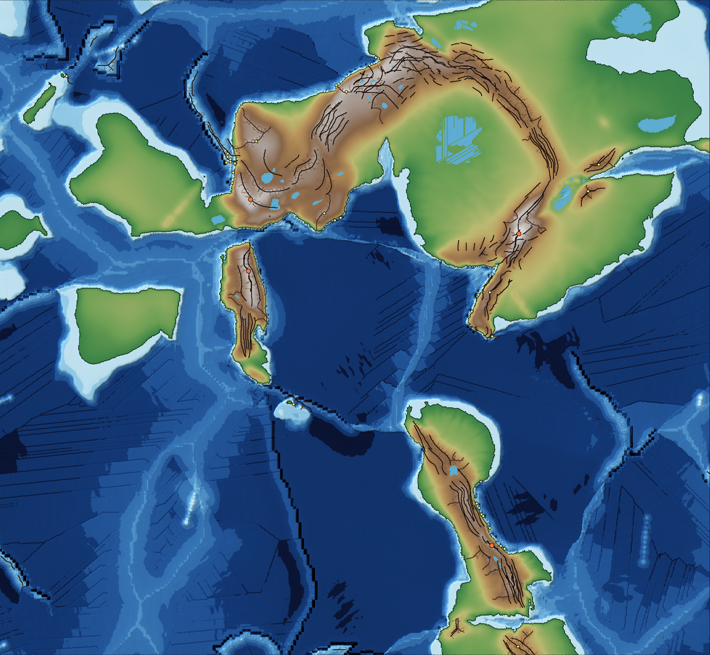

Остальные: `screenshots/v8/big/` (глубины, каньоны, высоты, вода, замкнутые понижения).
Мир 1000×800 при 25 км в режиме `world` — другой охват, чем 360×240 при 75 км, поэтому
материки не совпадают; тот же сид.

## 8. Рельеф без гексов, а гексы — только в конце?

Это верное направление, и HexWorld уже наполовину так устроен:

- Плиты, материки, макрорельеф, план гор, сегменты хребтов, бассейны — функции мировых
  координат, а не гексов.
- Возраст коры, ткань дна и прогибы платформ вычисляются в точке.
- Горы уже умеют давать высоту в любой точке: тест на сетке 1 км.

Гексы появляются в трёх местах, и там они важны:

1. **Геоистория (v3)** считается на мировом растре ~60 км: породы движутся, сталкиваются,
   подвигаются.
2. **Эрозия, реки и озёра (v4)** — сетка по определению: сток идёт от ячейки к ячейке.
3. **Классы и маски** (вода, формы дна) — по гексу.

**Что даст полная непрерывная поверхность:**

- одну карту, которую можно смотреть с любым масштабом гексов: 100, 25, 5 км;
- одинаковые хребты и береговые линии на любой сетке;
- детали мельче гекса (ущелья, каньоны) — внутри гекса как статистика: min / max / доля
  каньона.

**Цена:**

- Эрозию и реки придётся считать на сетке мельче итоговой: например 5–10 км растр, а гексы —
  выборкой из него.
  - Это в 10–50 раз больше ячеек, чем 360×240.
  - Без переноса горячих циклов в C/Numba это минуты–десятки минут на мир.
- Климат и вода от масштаба почти не зависят — их проще оставить на грубой сетке.

**Рекомендация — гибрид:**

1. **Мировой «план»** в мировых координатах. Уже есть: плиты, материки, хребты, бассейны,
   сегменты дна.
2. **Опорная растровая поверхность** фиксированного шага (например 10–15 км) для мира или
   региона. На ней — эрозия и сток один раз.
3. **Гексы любого размера** — выборка: среднее, min/max, уклон, доли (`sample_hexes`).
   Тогда смена масштаба не перезапускает геологию и эрозию, а только пересэмплирует.

Это отдельное ТЗ (по сути 5.x «многомасштабная поверхность»). Его первый кирпич — непрерывный
`sample_height(x, y)` для дна и бассейнов. В 4.6 он есть только как разрез, без деталей
мельче гекса.

## 9. Ограничения и статус

- **GEBCO / ETOPO не сравнивались:** реальные DEM не скачивались. Доли форм дна и глубины
  сравниваются с опубликованными диапазонами, не с вырезками.
- **Возраст коры — приближение.** Базовый мир без прошлого, медиана калибруется.
- **Пелагические осадки и заполнение бассейнов — допущения [А];** их объём показан, но не
  взят из баланса эрозии.
- **На гексах 75 км мелкие объекты — средние по гексу:** узкие рифты, pull-apart, осевые
  долины, каньоны.
- **Windows:**
  - сборка и тесты — по CI;
  - GUI на физическом экране Windows — **NOT VERIFIED**.
- **Совместимость:** геоистория — `geohistory-4`, проекты 4.5 нужно пересчитать с v3.
