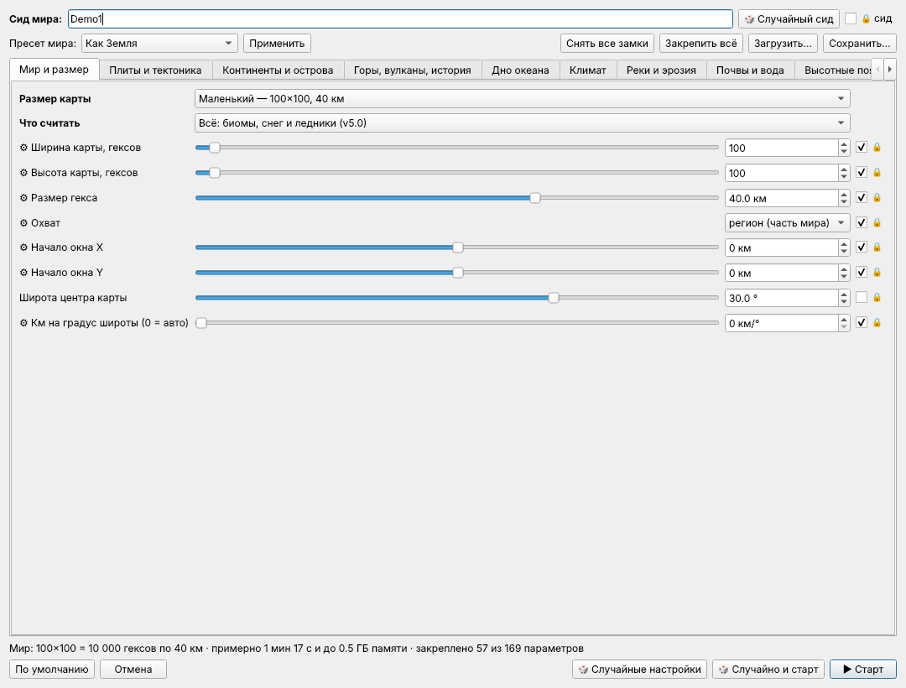
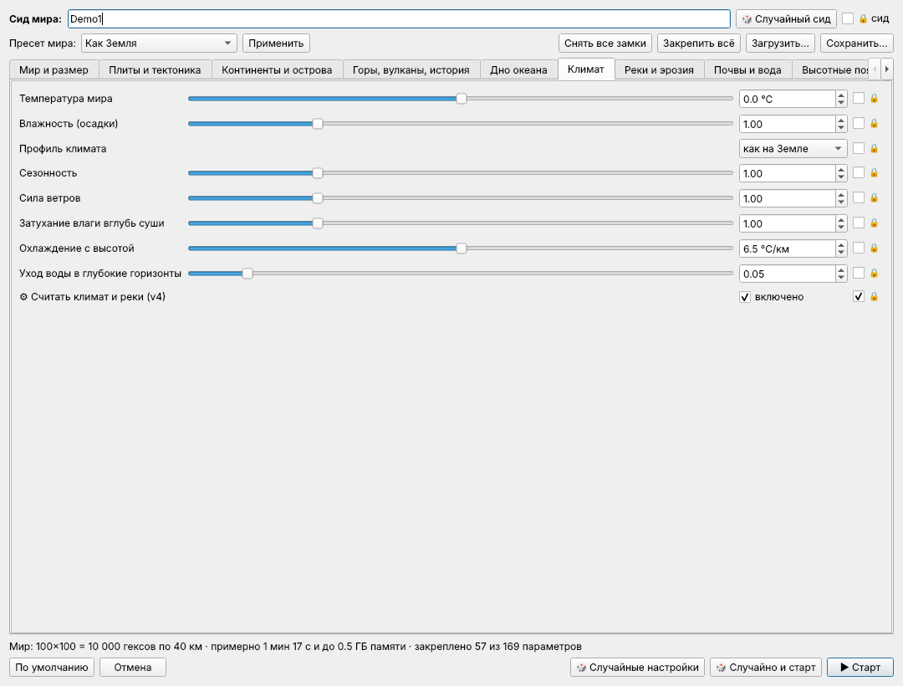
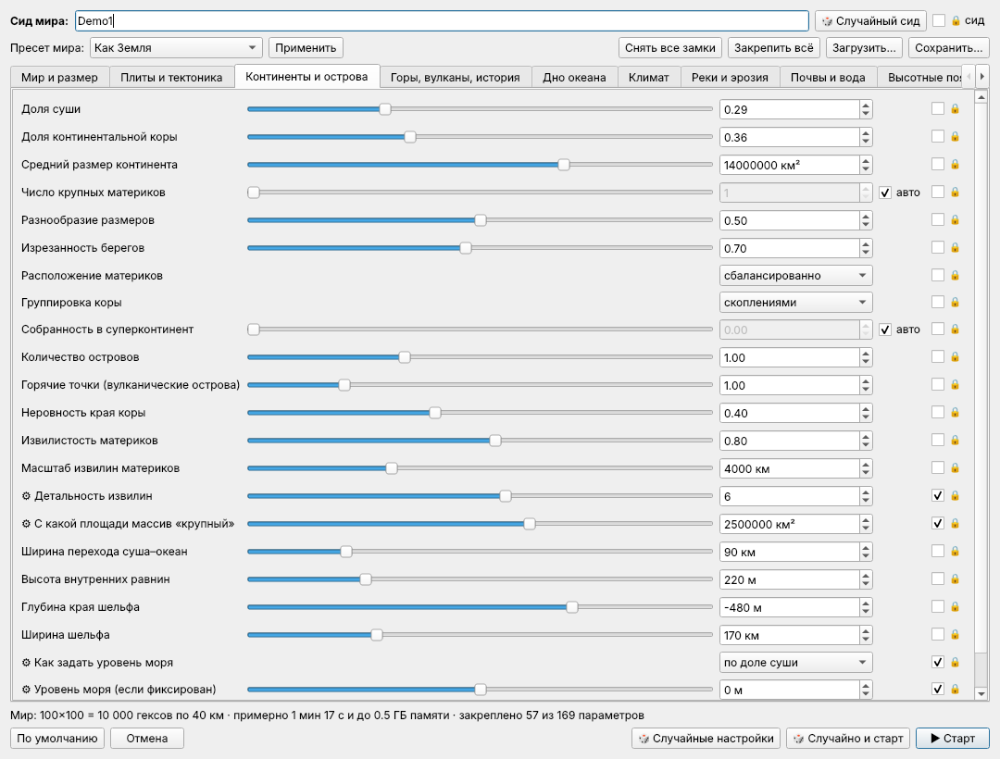
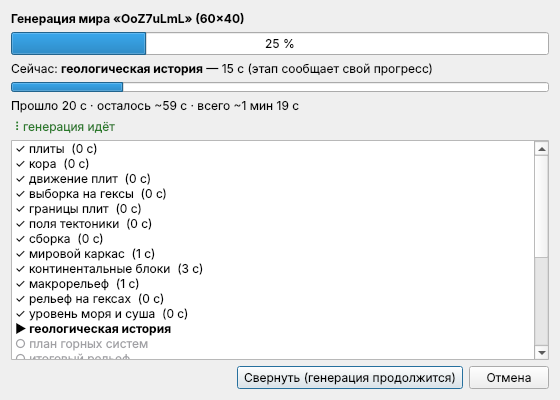

# Окно «Новый мир» и окно прогресса (5.1)

## Как открыть

- `hexworld gui` без проекта открывает окно «Новый мир» сразу при запуске. Чтобы оно не
  открывалось, задайте переменную `HEXWORLD_NO_START_DIALOG=1`.
- Кнопка «🌍 Новый мир…» вверху боковой панели открывает его в любой момент.

## Раскладка

| Место | Что там |
|---|---|
| верх | поле сида (латинские буквы и цифры, до 64 символов), «🎲 Случайный сид», «🔒 сид» (если сид введён вручную, замок ставится сам) |
| под сидом | готовые миры, «Применить», «Снять все замки», «Закрепить всё», «Загрузить…», «Сохранить…» |
| середина | вкладки групп: Мир и размер · Плиты и тектоника · Континенты и острова · Горы, вулканы, история · Дно океана · Климат · Реки и эрозия · Почвы и вода · Высотные пояса · Биомы и лёд · Технические |
| подвал | число гексов, оценка времени, оценка памяти, число закреплённых параметров, ошибки (красным) |
| низ слева | «По умолчанию», «Отмена» |
| низ справа | «🎲 Случайные настройки», «🎲 Случайно и старт», «▶ Старт» |

Каждая строка параметра состоит из:

- названия;
- ползунка от минимума до максимума (у широких диапазонов шкала логарифмическая);
- поля точного значения с единицей;
- галочки «авто» там, где генератор умеет выбирать сам;
- замка 🔒.

Подсказка к строке объясняет, что меняет параметр, и показывает путь в конфигурации,
единицу и диапазон случайного выбора. Технические параметры помечены ⚙.

## Замки и случайный выбор

- Закреплённый параметр (🔒) никогда не меняется при «Случайных настройках».
- Технические параметры и размер карты закреплены по умолчанию. Замки запоминаются между
  запусками.
- Случайные значения берутся из «разумного» диапазона (`rand`). Он уже полного диапазона
  ползунка, чтобы случайный мир оставался правдоподобным; вручную можно поставить любое
  значение.
- У параметров с «авто» в трети случаев остаётся «авто».
- Выбор воспроизводим: `settings_schema.randomize(values, locked, seed)`.

## Что можно настроить

В окне 169 параметров: это все поля `Config`, кроме сида, у которого своё поле, и
`simulation_bounds_km`, который всегда выводится сам. Примеры:

- «Температура мира», °C: сдвиг всех температур. При −8…−15 получается мир тундр и льдов,
  при +6…+15 — тепличный мир.
- «Влажность (осадки)».
- «Число литосферных плит».
- «Доля суши».
- «Средний размер континента».
- «Число крупных материков».
- «Количество островов» (`terrain.island_amount`, 0…3): плотность подводных гор, шельфовые
  архипелаги и высота островных дуг.
- «Горность (поднятие)».
- «Длительность истории».
- «Глубина океанского ложа».
- «Длительность эрозии».
- «Граница леса».
- «Древние ледниковые щиты».

Полный список — `src/hexworld/settings_schema.py`; покрытие проверяет тест.

### Размеры карты

| Шаблон | Гексов | Оценка времени |
|---|---|---|
| Крошечный — 60×40, 75 км | 2 400 | ~1 мин |
| Маленький — 100×100, 40 км | 10 000 | ~1,3 мин |
| Средний — 240×160, 40 км | 38 400 | ~1,5 мин |
| Большой — 360×240, 25 км | 86 400 | ~1,7 мин |
| Очень большой — 500×300, 25 км | 150 000 | ~2 мин |
| Огромный — 1000×800, 25 км | 800 000 | ~5 мин |

Можно выбрать «Свой размер (ниже)» и задать ширину, высоту, размер гекса и охват вручную.

Время дано для одного ядра Linux-контейнера. Большую часть первой минуты занимает
геологическая история: её стоимость почти не зависит от размера окна.

### Готовые миры

- Как Земля
- Ледниковый период
- Снежок (ледяная планета)
- Тепличный мир
- Пустынный мир
- Влажные тропики
- Архипелаги
- Пангея
- Горный мир
- Старый спокойный мир
- Водный мир

Готовый мир меняет только свои параметры; остальные остаются как были.

## Файл настроек

«Сохранить…» записывает JSON:

```json
{
  "format": "hexworld-world-settings-1",
  "seed": "Ab12",
  "through": "v50",
  "values": {"plates.count": null, "climate.temperature_offset_c": -6.0, "...": "..."},
  "locked": ["width", "height", "climate.temperature_offset_c"]
}
```

Ключи `values` — пути параметров:

- `раздел.поле`;
- `раздел.поле[i]` — элемент пары, например `terrain.age_depth_transition_ma[0]`;
- `раздел.поле:член` — включение элемента набора, например `terrain.basins:rift_graben`.

Значение `null` означает «авто».

## Окно прогресса

Во время генерации окно показывает:

- общий процент;
- текущий этап и полосу этапа. Этап либо сообщает свою долю (история, топоклимат, разгон
  льда), либо получает оценку по времени, и это подписано;
- сколько прошло, сколько осталось и сколько всего, по наблюдаемой скорости;
- список этапов: ✓ готово (с секундами), ▶ сейчас, ○ впереди;
- «пульс»: значок обновляется 7 раз в секунду, даже когда этап ничего не сообщает. Если
  этап молчит дольше 20 с, появляется надпись «этап долгий, это нормально… программа не
  зависла».

Кнопки:

- «Свернуть» — генерация продолжится; строка состояния главного окна тоже показывает
  этап и остаток.
- «Отмена» — остановка после текущего шага; прежние данные сохраняются.

Ядро не зависит от Qt (`hexworld/progress.py`, `ProgressTracker`). У каждого этапа есть
вес «постоянная часть + часть на миллион гексов». Общий процент никогда не уменьшается.
CLI `hexworld generate` печатает те же сведения: `[ 42%] этап (прошло…, осталось ~…)`.

## Снимки (offscreen Qt, Linux)






Окно на физическом экране Windows — NOT VERIFIED.

## Эскиз, код мира, предупреждения (HexWorld 1.0)

- **Эскиз** справа в окне — тот же сид и настройки на грубой сетке (`world_tools.preview_config`:
  ≤ 96 гексов по длинной стороне, грубый каркас, крупный шаг истории, без эрозии и v4.6),
  4–10 секунд, в фоне. Пересчитывается сам через секунду после изменения
  («обновлять сам») или по «⟳». Слои: биомы, высоты, температура, осадки, материки, плиты;
  под картинкой — доля суши, высшая точка, температура и осадки суши, засушливость, лёд,
  главные биомы. Климат эскиза не зависит от разрешения сетки, поэтому согласуется с полной
  картой; детали (мелкие острова, реки) — только на полной карте.
- **Код мира** — «📋 Код мира» копирует `HW1-…` (сид + все отличия от настроек по умолчанию,
  сжатый JSON), «📥 Вставить код…» восстанавливает мир. CLI: `hexworld generate --code HW1-…`,
  `hexworld code ПАПКА_ПРОЕКТА`.
- **Предупреждения** (оранжевым внизу) — противоречия и неожиданные последствия настроек
  (`world_tools.conflicts`): материков больше, чем плит; биомы без климата; суша намного
  больше континентальной коры; очень холодный и влажный мир; нет истории или эрозии и т. п.
- **Что будет пересчитано** (зелёным) — если открыт мир, окно говорит, какие этапы
  возьмутся из него без пересчёта и с какого начнётся расчёт (`world_tools.regeneration_plan`).
- **Подсказка** каждого параметра называет вкладки карты, на которые он влияет.
